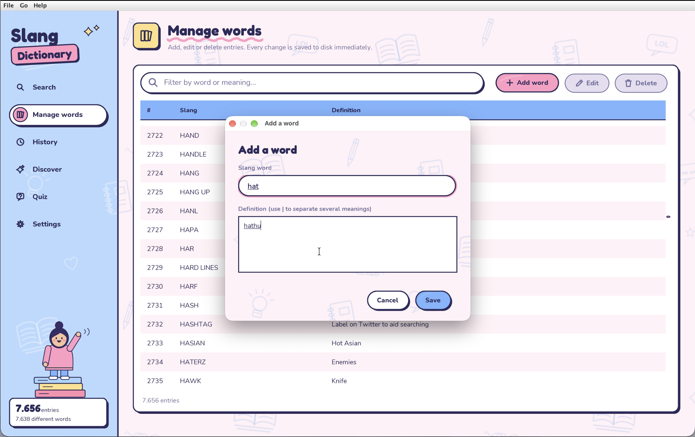
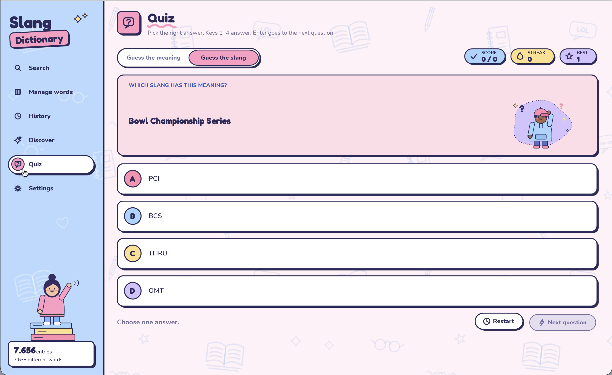
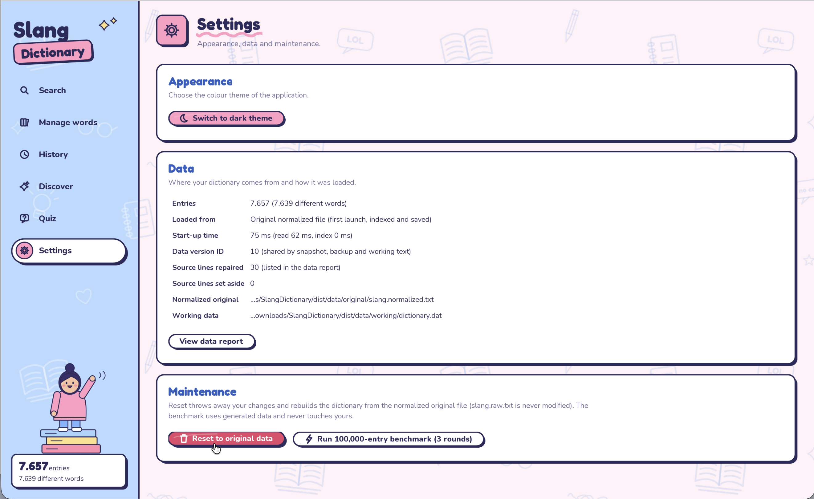

<div align="center">

# 📖 Slang Dictionary

**Từ điển tiếng lóng tiếng Anh viết bằng Java Swing — tìm kiếm tức thì trên 100.000 từ, lưu trữ an toàn, có quiz và giao diện sáng/tối.**

[](https://github.com/huynhanhthu777/Slang-Dictionary/actions/workflows/ci.yml)


</div>

---

## ✨ Tính năng

Ứng dụng hoàn thành đủ **10 chức năng** của đề bài (Đồ án #1 – Slang Word, môn CSC13002):

| # | Chức năng | Vị trí trong app |
|---|---|---|
| 1 | Tìm theo **slang word** (khớp chính xác, gợi ý prefix khi gõ) | `Search → By slang` |
| 2 | Tìm theo **definition** (liệt kê mọi slang có định nghĩa chứa từ khóa, tô vàng từ khóa) | `Search → By definition` |
| 3 | **Lịch sử** các slang đã tìm (lưu qua các lần mở app, xóa được) | `History` |
| 4 | **Thêm** slang mới; nếu trùng thì hỏi *Overwrite / Keep both / Cancel* | `Manage → Add word` |
| 5 | **Sửa** slang | `Manage → Edit` |
| 6 | **Xóa** slang (có hộp thoại xác nhận) | `Manage → Delete` |
| 7 | **Reset** về danh sách gốc | `Settings → Reset to original data` |
| 8 | **Random** slang (*On this day*) | `Discover` |
| 9 | Quiz: cho 1 slang, chọn 1 trong **4 định nghĩa** | `Quiz → Guess the meaning` |
| 10 | Quiz: cho 1 định nghĩa, chọn 1 trong **4 slang** | `Quiz → Guess the slang` |

Ngoài ra: phím tắt (`Ctrl/Cmd+K` tìm nhanh, `1–4` trả lời quiz), giao diện sáng/tối, benchmark 100.000 từ ngay trong `Settings`.

## 🖼️ Giao diện

<table>
  <tr>
    <td align="center"><br><sub><b>Manage</b> — thêm, sửa, xóa slang</sub></td>
    <td align="center"><br><sub><b>Quiz</b> — đố vui 4 đáp án</sub></td>
  </tr>
  <tr>
    <td align="center" colspan="2"><br><sub><b>Settings</b> — reset dữ liệu, benchmark, giao diện</sub></td>
  </tr>
</table>

## 🚀 Chạy thử

Cần **JRE/JDK 17 trở lên**.

```bash
# Chạy file JAR đã build sẵn (thư mục data/ nằm cạnh file JAR)
java -jar dist/SlangDictionary.jar
```

Đổi vị trí lưu dữ liệu: `java -Ddictionary.home=/duong/dan -jar dist/SlangDictionary.jar`

### Tự build

```bash
./build.sh          # Linux / macOS  (Windows: build.bat) — chỉ cần JDK 17+, không cần Maven
./build.sh test     # build + chạy toàn bộ unit test (đặt JUNIT_CONSOLE=/đường/dẫn/junit-platform-console-standalone.jar)

# hoặc dùng Maven
mvn clean verify                 # Windows / macOS
xvfb-run -a mvn clean verify     # Linux không có màn hình (test GUI cần display ảo)
```

## ⚡ Hiệu năng

Mục tiêu của đề: tìm kiếm **dưới 1 giây** với tối đa **100.000** slang word. Số đo thật (7 vòng, máy 1 CPU, JDK 21; chi tiết ở [`docs/benchmarks/benchmark-100k.txt`](docs/benchmarks/benchmark-100k.txt)):

| Thao tác (100.000 từ) | Trung vị |
|---|---|
| Tìm theo slang | **~1,4 µs** |
| Gợi ý prefix | ~0,06 ms |
| Tìm theo definition (trung bình) | **~2,4 ms** (tệ nhất ~67 ms) |
| Add / Edit / Delete (đã gồm lưu file) | ~0,2 – 0,3 s |
| Reset về dữ liệu gốc | ~0,45 s |
| Khởi động lần sau (dùng lại index đã lưu) | ~0,25 s |

> Số liệu phụ thuộc máy và ổ đĩa. Có thể tự đo lại bằng **Settings → Run 100,000-entry benchmark**.

## 🧠 Thiết kế

### Cấu trúc dữ liệu

Toàn bộ dữ liệu được nạp lên bộ nhớ khi mở app và tổ chức để truy vấn nhanh:

| Cấu trúc | Dùng cho | Độ phức tạp |
|---|---|---|
| `HashMap<String, ArrayList<Long>>` (slang → danh sách id) | tìm theo slang, một slang có nhiều nghĩa | O(1) |
| `HashMap<Long, SlangEntry>` | truy cập / sửa / xóa theo id | O(1) |
| `ArrayList<Long>` + vị trí, xóa kiểu *swap-with-last* | random, xóa | O(1) |
| `ArrayList<String>` đã sắp xếp + binary search | gợi ý theo prefix | O(log n + k) |
| Chuỗi `lowercase` cache trong entry | tìm theo definition | quét tuyến tính |

### Kiến trúc phân tầng

```
src/main/java/dictionary/
├── ui/           Giao diện Swing (các trang Search, Manage, History, Discover, Quiz, Settings)
├── service/      DictionaryService (nghiệp vụ, lưu + hoàn tác), QuizService, Benchmark
├── repository/   DictionaryRepository: index trong bộ nhớ (HashMap, ArrayList)
├── storage/      FileStorage (mọi thao tác file), SlangParser, NormalizeData
└── model/        SlangEntry, SearchRecord, QuizQuestion, ...
```

Thao tác ghi (Add/Edit/Delete/Reset) chạy trên **một luồng ghi duy nhất**, thao tác đọc chạy nền, mọi cập nhật giao diện quay về Event Dispatch Thread nên giao diện không bị đứng ngay cả với 100.000 từ.

### Lưu trữ dữ liệu

```
data/original/slang.raw.txt          file slang gốc của đề (không bao giờ bị ghi)
data/original/slang.normalized.txt   bản đã chuẩn hóa MỘT LẦN từ file gốc (Reset đọc file này)
data/original/malformed-report.txt   báo cáo từng dòng lỗi đã xử lý
data/working/dictionary.dat          index đã lưu (magic + version + CRC32) → lần sau không phải index lại
data/working/slang.working.txt       dữ liệu của người dùng sau khi add / edit / delete
data/working/history.tsv             lịch sử tìm kiếm
```

- **Hai nguồn dữ liệu tách riêng:** file gốc đã chuẩn hóa và file làm việc của người dùng; bấm *Reset* thì bỏ file làm việc và nạp lại file gốc.
- **Không bỏ sót dòng nào:** parser xử lý các dòng sai định dạng của file gốc theo quy tắc đã kiểm chứng và ghi vào `malformed-report.txt` (7.662 dòng → 7.656 entry, 46 dòng được ghi nhận).
- **Ghi an toàn:** ghi file tạm → `fsync` → đổi tên; có backup `.bak`; kiểm tra CRC khi mở. Nếu index hỏng, app tự dựng lại từ file làm việc và báo cho người dùng.

## 🧪 Kiểm thử

Khoảng **140 test JUnit 5** ([`src/test/java/dictionary`](src/test/java/dictionary)): parser, repository, tìm kiếm, quiz, kiểm tra dữ liệu nhập, mô phỏng lỗi/crash ở từng bước ghi file, hiệu năng 100.000 từ và test giao diện Swing thật. Mỗi lần push, **GitHub Actions** ([`ci.yml`](.github/workflows/ci.yml)) tự build, chạy test (với màn hình ảo `xvfb`) và đóng gói JAR.

## 📁 Cấu trúc repo

```
.
├── src/main/java/dictionary/   mã nguồn ứng dụng
├── src/test/java/dictionary/   unit test + test giao diện
├── data/original/              dữ liệu gốc và bản chuẩn hóa
├── dist/                       SlangDictionary.jar + data/ đi kèm
├── docs/                       ảnh chụp màn hình, benchmark, kịch bản video
├── .github/workflows/ci.yml    CI
├── build.sh · build.bat        build không cần Maven
├── pom.xml                     cấu hình Maven
├── DiemTuDanhGia.txt           bảng tự đánh giá 10 chức năng
└── NGUON_THAM_KHAO.txt         nguồn tham khảo và công cụ hỗ trợ
```

## 📚 Nguồn tham khảo & công cụ hỗ trợ

- Java thuần (JDK 17+, Swing/AWT, `java.io`/`java.nio`, Collections); JUnit 5 chỉ dùng cho test.
- Font **Fredoka** và **Nunito** (SIL Open Font License), đóng gói trong `src/main/resources/fonts`.
- Có sử dụng công cụ AI hỗ trợ trong quá trình làm; tỷ lệ và chi tiết được khai trong [`NGUON_THAM_KHAO.txt`](NGUON_THAM_KHAO.txt) và [`DiemTuDanhGia.txt`](DiemTuDanhGia.txt).

## 👤 Tác giả

**Huỳnh Anh Thư** — MSSV 24127247
Đồ án môn học *CSC13002 – Lập trình ứng dụng Java*, Khoa Công nghệ Thông tin, Trường ĐH Khoa học Tự nhiên – ĐHQG-HCM.
